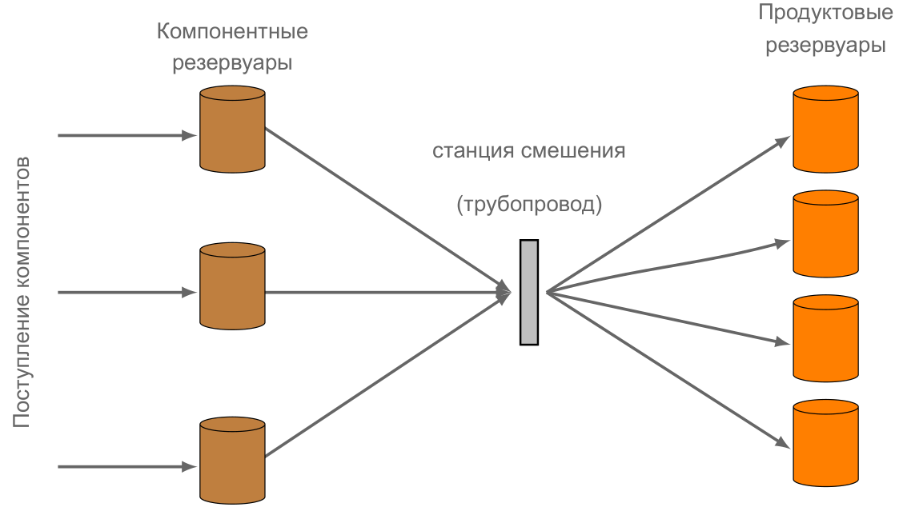
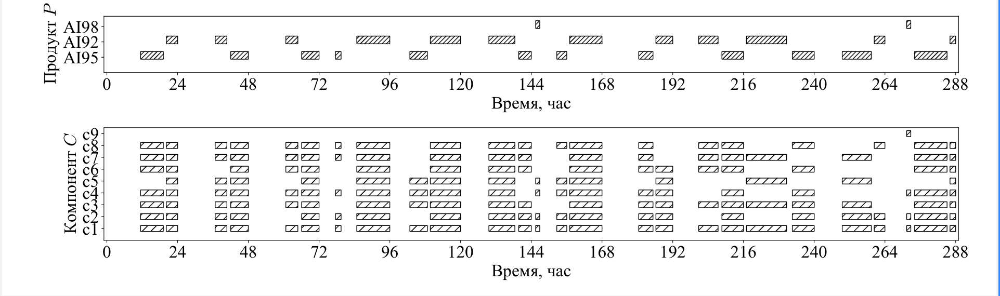

# Задача построения графика смешения бензинов (blend_problem)

В данном репозитории представлен исходный код программного комплекса для расчета графика приготовления бензинов. 
Проект создан для демонстрации решения задачи календарного планирования производства на примере нефтеперерабатывающего завода.

## Структура проекта

*   `/init_data` - Исходные данные (сценарии) для расчета
*   `/results` - Результаты расчетов
*   `bp_model_data.py` - скрипт с методами для считывания данных, экспорта результатов расчета:
    *   `output_folder_check` - создает папку под новый расчет в пути `../results/`
    *   `ModelData` - класс для считывания и хранения данных
        * `import_data_excel` - считывание данных из файла `.xlsx` в экземпляр класса `ModelData`.
        * `create_params` - создание вспомогательных параметров для модели
        * `read_sets` - инициализация множеств 
        * `read_parameters` - инициализация параметров
        * `parameter` - вспомогательный метод при обработке данных
        * `scalar` - вспомогательный метод при обработке данных
        * `calc_q` - метод для линеаризации ограничений по расчету давления насыщенных паров (RVP)
    *   `ModelVars` - класс для хранения переменных
    *   `add_variables` - метод для инициализации переменных
    *   `gantt_diagram` - визуализация решения задачи
    *   `get_var_values` - метод для обработки данных о решении задачи
    *   `sol2excel` - экспорт решения в файл `.xlsx`
*   `run_bp_model.py` - скрипт для построения и запуска решения математической модели:
    *   `gasoline_logic_def` - блок ограничений модели
    *   `blend_logic_def` - блок ограничений модели
    *   `pump_constr_def` - блок ограничений модели
    *   `comp_storage_def` - блок ограничений модели
    *   `plan_constr_def` - блок ограничений модели
    *   `qual_constr_def` - блок ограничений модели
    *   `set_objective` - блок штрафных ограничений модели и целевая функция
*   `README.md`

## Постановка задачи
Пусть известны следующие данные :

  - Горизонт планирования --- временной промежуток, на котором необходимо построить график;
  - Набор компонентов, их качества, начальные запасы, стоимости и скорости выработки;
  - Набор продуктов с установленными минимальными и максимальными качественными характеристиками;
  - Набор заказов (планов на производство) каждого продукта на горизонте планирования (т.~е. профиль спроса);
  - Максимальная производительность каждой станции смешения;
  - Набор резервуаров для хранения с минимальной и максимальной вместимостью.

Схема производственного процесса с 1 станцией смешения приведена на схеме ниже.

### Технологические ограничения 
 - Станция смешения производит продукт с учетом минимального количества разового приготовления смеси;
 - Станция смешения может производить не более одного продукта одновременно. После начала смешивания она должна проработать какое-то минимальное время, прежде чем она сможет переключиться на другой бензин;
 - Станция смешения требует минимального времени на настройку в процессе смены продукта;
 - Станция смешения может загружать не более одного резервуара продукта в любое время;

### Допущения при построении математической модели:
 - Выработка каждого компонента кусочно-постоянна;
 - Качества компонентов кусочно-постоянны;
 - В станции смешения происходит идеальное перемешивание;
 - Для каждого компонента имеется только один резервуар;
 - Для станции смешения время переключения между смешиванием продуктов зависит от выбранного продукта;
 - Каждый заказ включает только один продукт (один исходный заказ, включающий разные продукты, может быть разбит на заказы каждого конкретного продукта);
 - Каждый заказ выполняется в течение горизонта планирования.

## Решение задачи

 - Математическая модель реализована на Python 3.8 с использованием библиотеки 'coptpy'. При решении построенной модели требуется иметь лицензию на решатель COPT.
 - Считывание данных проводится из файлов '.xlsx' с определенной структурой входных данных. По окончанию расчета создается копия файла входных данных с дополненной информацией по результатам решения задачи.
 - В случае, если сформированная на входных данных задача milp оказывается несовместной, для вспомогательной информации с помощью встроенных методов COPT запускается метод поиска минимального несовместного множества ограничений. По этим данным можно отследить, какая группа ограничений приводит к противоречивым требованиям от искомого решения задачи. Таким образом можно будет отладить работу модели для дальнейшего избегания подобных случаев.
 - Для каждого поданного на вход сценария после успешного решения задачи строится визуализация в виде диаграммы Ганта.

Структура работы программы отражена в блок-схеме.

